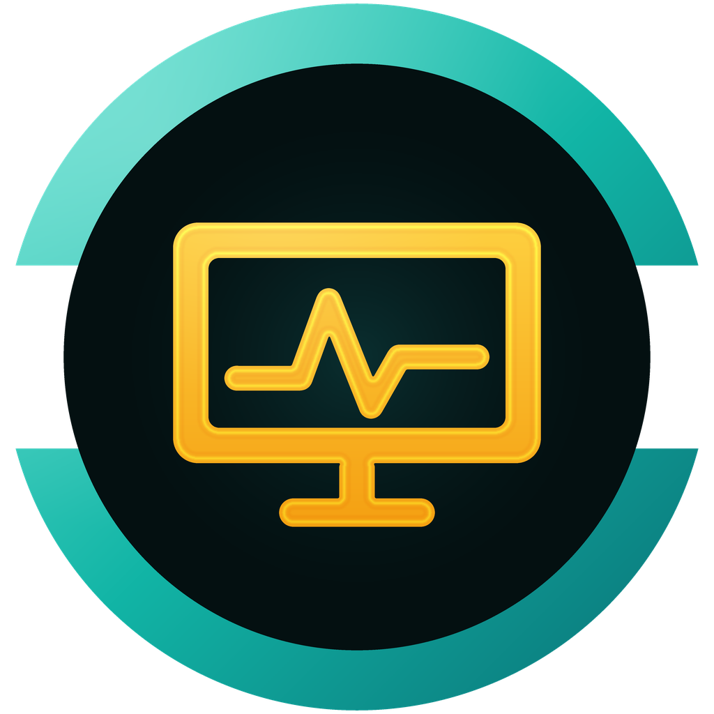
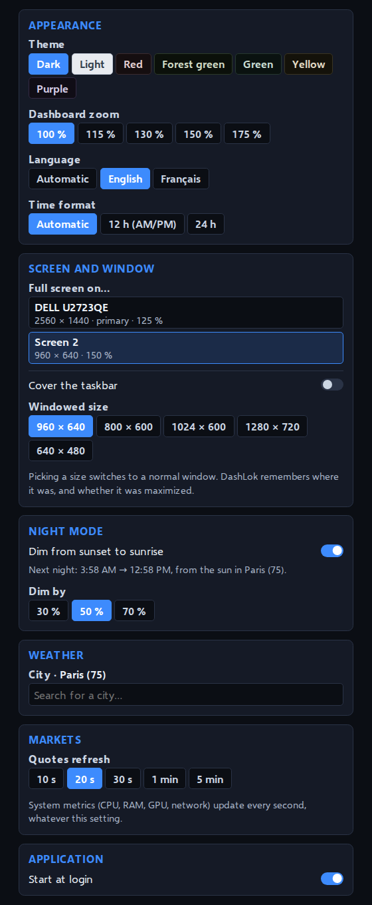

<p align="center">
  
</p>

<h1 align="center">DashLok</h1>

<p align="center">
  <strong>Markets, weather and system load,<br>on the small screen next to your monitor.</strong>
</p>

<p align="center">
  Free and open source (MIT) · no account · no telemetry<br>
  Windows · macOS · Linux · English and French
</p>

<p align="center">
  <a href="https://github.com/LokLakh-s/DashLok/releases/latest"><b>Download</b></a> ·
  <a href="#features">Features</a> ·
  <a href="#any-screen">Any screen</a> ·
  <a href="#install">Install</a> ·
  <a href="#roadmap">Roadmap</a>
</p>

<p align="center">
  
</p>

---

DashLok turns a spare screen into an always-on dashboard. It lives in the
notification area and covers the screen of your choice, above the taskbar:
prices on the left, the machine on the right, the weather underneath. Nothing to
log into, nothing to configure but a city.

It was designed for a 3.6-inch, 960 × 640 panel (about 325 PPI) seen from 60 cm,
so everything is big, high-contrast and readable at a glance. It adapts just as
well to bar screens, portrait screens and ordinary monitors.

> **Status** — Windows 10/11 is the version used daily. macOS 12+ and Linux
> (x64) are built and tested on CI but still waiting for more real-world
> feedback: [open an issue](https://github.com/LokLakh-s/DashLok/issues) if
> something looks off on your machine.

## Features

<table>
<tr>
<td width="33%" valign="top">

### Markets
Three badges per row: price, 24-hour change and a 12-hour sparkline. A click
opens a full chart over 14 periods, from 1 hour to 5 years.

**Metals** · gold, silver, platinum, palladium, copper<br>
**Currencies** · any pair among 26<br>
**Crypto** · the whole Binance catalog

If a source stops answering, the badge keeps the last price, greyed out, and the
status dot turns red.

</td>
<td width="33%" valign="top">

### Weather
Conditions and forecast for the city you pick: temperature, feels-like, min/max,
rain, wind and gusts, thunderstorm risk.

The Moon's phase (computed on your machine), sunrise, sunset and day length sit
under the icon. A faded curve behind shows the next 24 hours; click it for the
hour-by-hour view. The rest of the card opens the Windy map.

</td>
<td width="33%" valign="top">

### System
Refreshed every second.

**CPU** · one bar per logical core<br>
**RAM** · used, total, available<br>
**GPU** · load, memory, fan, temperature<br>
**Network** · live rates, ping to Quad9, 90-second history, totals

A click on a card opens its **history** over 1 min, 10 min or 1 h.

</td>
</tr>
</table>

<p align="center">
  
  
</p>
<p align="center">
  
  
</p>

### Made to live on a second screen

- **Own settings window**: it opens apart from the dashboard (tray menu →
  *Settings…*), so you can move it to your main screen while the dashboard stays
  full screen on the small one. Changes apply at once.
- **Remembers its place**: the chosen screen, and, in a normal window, its
  position, size and whether it was maximized. If the screen is missing at login
  (not detected yet, unplugged), the window waits hidden instead of covering
  your main screen, and comes back with it.
- **Night mode** dims the screen from sunset to sunrise at the weather city.
- **7 muted themes**, zoom from 100 to 175 %, 12-hour or 24-hour time, English or
  French (following the system, or picked).
- **Start at login**, and updates from the tray menu.

<p align="center">
  
</p>

## Any screen

Any screen connected as a display (HDMI, DisplayPort, USB-C or DisplayLink):
small 3.5 to 8-inch panels, bar screens, a spare monitor, a tablet used as a
second screen. The layout follows the shape of the screen:

| Shape | Screens | Layout |
|---|---|---|
| **Landscape** | close to 3:2 or 4:3 (960 × 640, 1024 × 600, 800 × 480…) | the reference layout |
| **Bar** | 2.4:1 and wider (1920 × 480, 2560 × 720, 1280 × 400…) | badges, weather and system side by side |
| **Portrait** | 4:5 and narrower (480 × 800, 600 × 1024, 480 × 1920…) | one column |
| **Large** | from about 1500 × 850 | history curves in the system cards, 24-hour temperature and next 12 hours one by one |

<p align="center">
  
</p>
<p align="center">
  
</p>
<p align="center">
  
  
</p>

On first launch DashLok covers such a secondary screen by itself (960 × 640
first, then the smallest small panel or bar screen); ordinary monitors are only
used when picked in *Full screen on…*.

Small "sensor panel" screens sold with their own software and driven over a
USB serial link are not displays for the system: DashLok cannot use them.

## Install

From the [latest release](https://github.com/LokLakh-s/DashLok/releases/latest):

| System | File | First launch |
|---|---|---|
| Windows 10/11 | `DashLok.Setup.<version>.exe` | Not code-signed: SmartScreen asks for confirmation (*More info* → *Run anyway*) |
| macOS 12+, Apple silicon | `DashLok-<version>-arm64.dmg` | Not notarized: *System Settings* → *Privacy & Security* → *Open Anyway* |
| macOS 12+, Intel | `DashLok-<version>-x64.dmg` | Same as above |
| Linux x64 | `DashLok-<version>-x86_64.AppImage` (make it executable) or `DashLok-<version>-amd64.deb` | — |

On Linux, DashLok runs under XWayland: native Wayland does not let an app
place its window on a given screen nor keep it on top. GNOME only shows the
tray icon with the AppIndicator extension; without it, the menu still opens
with a right click in the dashboard.

To check a download, compare it with `SHA256SUMS` in the release, or verify its
build provenance with the GitHub CLI:

```bash
gh attestation verify DashLok.Setup.<version>.exe -R LokLakh-s/DashLok
```

## Usage

Click the notification area icon to show or hide the dashboard. The menu (add
a row, settings, refresh, updates, quit) opens with a right click on that icon,
a right click anywhere in the dashboard (long press on a touch screen), or the
⋮ button that appears when hovering the top bar.

| | |
|---|---|
| `Ctrl+Shift+Q` (`Ctrl+Option+Q` on macOS) | Quit — **emergency exit**, as the window has no title bar and no taskbar button |
| ✕ on a badge (hover) | Remove the row |
| `Esc` | Close the open panel |

## Updates

DashLok checks this repository's releases every 30 minutes and shows a
notification; right-click the icon → *Install the update*.

On **Windows** it installs the update itself:

- **Same Electron version**: only the app archive (`app-electron<major>.asar`)
  is downloaded; a small helper swaps it once DashLok has closed, then
  restarts it. Log: `%TEMP%\dashlok-update.log`.
- **New Electron version**: the archive would not run on the old engine, so
  DashLok downloads the full installer and runs it.

Every download is checked against the SHA-256 digest published by GitHub.

On **macOS and Linux** it opens the release page: a signed app bundle, a
read-only AppImage or a system package cannot be patched in place.

## Data sources

All free, **no API key**. Requests go out from the main process, with a
10-second timeout.

| Data | Quotes | History |
|---|---|---|
| Metals | [gold-api.com](https://gold-api.com) (spot) | Yahoo Finance, rescaled to the spot price |
| Currencies | Yahoo Finance | Yahoo Finance |
| Crypto | Binance public market data (`data-api.binance.vision`) | Binance |
| Weather | [Open-Meteo](https://open-meteo.com) | — |
| Ping | ICMP echo to Quad9 (9.9.9.9) with the system's `ping`, once a second | kept 1 hour, like the other metrics |

- Yahoo quotes metals as **futures** (`GC=F` trades about 1 % above spot). The
  price shown comes from gold-api, and the chart is scaled by
  `spot / last close` so that it ends exactly on that price.
- Yahoo Finance has no official public API: it may change or throttle without
  notice. DashLok then keeps showing the last known prices.

**Privacy** — no account, no telemetry. The only network traffic is to the
sources above (the ping included) and to the GitHub API for updates. Settings stay on your computer, in
`dashboard.json`: `%APPDATA%\DashLok` on Windows, `~/Library/Application
Support/DashLok` on macOS, `~/.config/DashLok` on Linux. An install that predates
the rename (the app was called Klakboard until 1.10) keeps its `Klakboard` folder.

## Build from source

Requires Node.js 22 or later.

```bash
npm ci
npm test         # unit tests under plain Node, no Electron needed
npm start        # run without packaging
npm run dist     # packages for the current system, in dist/
```

**Continuous integration** — every push and pull request runs the tests on
Windows, macOS and Linux, including a smoke test that reads the real system
metrics of each one; pull requests also build the packages of the three systems.

**Releasing** — bump `version` in `package.json` and push to `main`. The
[Release workflow](.github/workflows/release.yml) runs the tests, builds the
Windows, macOS and Linux packages on GitHub-hosted runners, then creates the
`klakboard-v<version>` tag (the name from before the rename, which installed
versions look for) and release with notes, checksums and a build
provenance attestation.

## Architecture

No npm dependency at runtime and no native module. System metrics come from
built-in tools, through one long-running process wherever spawning one each
second would cost too much (PowerShell takes ~0.8 s to start):

| Metric | Windows | macOS | Linux |
|---|---|---|---|
| CPU | Node `os` | Node `os` | Node `os` |
| RAM | Node `os` | `vm_stat` (`os.freemem()` only counts free pages) | Node `os` |
| GPU, NVIDIA | `nvidia-smi -lms`, one process | — | `nvidia-smi -lms`, one process |
| GPU, others | performance counters (CIM), one PowerShell process | `ioreg` (IOAccelerator) | amdgpu sysfs |
| Network | `Get-NetAdapterStatistics`, one PowerShell process | `netstat -ibn` | `/proc/net/dev` |
| Ping | `ping.exe`, one process (any Windows language) | `ping`, one process | `ping`, one process |

```
main.js       main process: windows, screens, tray, IPC, settings, updates
display.js    picks the screen to cover
markets.js    market sources and chart normalisation
weather.js    Open-Meteo weather and icon choice
astro.js      Moon phase, computed from the date (Meeus), shared by page and tests
system.js     CPU / RAM / GPU / network metrics, sampled every second
history.js    metrics history: 10 min at 1 s, 1 h at 10 s (main process)
platform/     metric sources per system (win32, darwin, linux, nvidia, ping)
autostart.js  start at login on Linux (XDG autostart entry)
updates.js    finds and downloads releases
updater.js    swaps the app archive after exit (runs outside the app)
preload.js    IPC bridge (context isolation on)
renderer.js   dashboard rendering: badges, charts, history views
settings.*    the settings window (page, script, style)
charts.js     time-series charts on canvas
i18n.js       interface strings (English, French), shared by main and page
style.css     themes, type scale, landscape / bar / portrait layouts
fonts/        Selawik (Segoe UI metrics) for systems without Segoe UI
test/         node:test suites; main.js runs against a fake electron module
```

The page runs under a strict Content Security Policy (no remote content, no
inline script), and API data never goes through `innerHTML`. Settings are
written to a temporary file then renamed, so a power cut cannot leave a
truncated file; an unreadable file is set aside, never overwritten.

## Contributing

Bug reports, hardware reports (a GPU, a screen or a system that does not behave)
and ideas are welcome in the [issues](https://github.com/LokLakh-s/DashLok/issues).
Pull requests too: run `npm test` first, it needs no Electron. Code, comments and
commit messages are in English.

## Roadmap

1. ~~Public release~~ (1.6.0), ~~English and French, menu inside the window,
   bar and portrait layouts~~ (1.7.0), ~~macOS and Linux, GPU load for AMD and
   Intel~~ (1.8.0), ~~history views and large screens~~ (1.9.0).
2. **Next** (in no particular order):
   - **Run on as much hardware as possible**: every GPU vendor and sensor on
     each system (load, memory, fan, temperature), ARM (Windows on ARM, Linux
     arm64, Raspberry Pi class), older systems, and every kind of small or odd
     screen (bars, portrait, 4:3, high-DPI, rotated).
   - **macOS and Linux as first-class as Windows**: they are built and tested
     on CI but have not run on a real Mac or Linux desktop yet. Checking them
     on real machines (Wayland and X11, several desktops) comes first.
   - **Free and open source, all the way**: MIT stays. No proprietary
     dependency; bundled fonts and icons stay under free licences, and data
     sources that need no account or key are preferred.
   - ~~**A new README**~~: shorter, more visual, built around the screenshots.
3. More ideas are welcome in the issues.

The full review behind this plan, in French: [docs/AUDIT-2026-10-16.md](docs/AUDIT-2026-10-16.md).

## License

[MIT](LICENSE). Weather icons: [Meteocons](https://github.com/basmilius/weather-icons) by Bas Milius (MIT).
Font: [Selawik](https://github.com/microsoft/Selawik) by Microsoft (SIL Open Font License).
